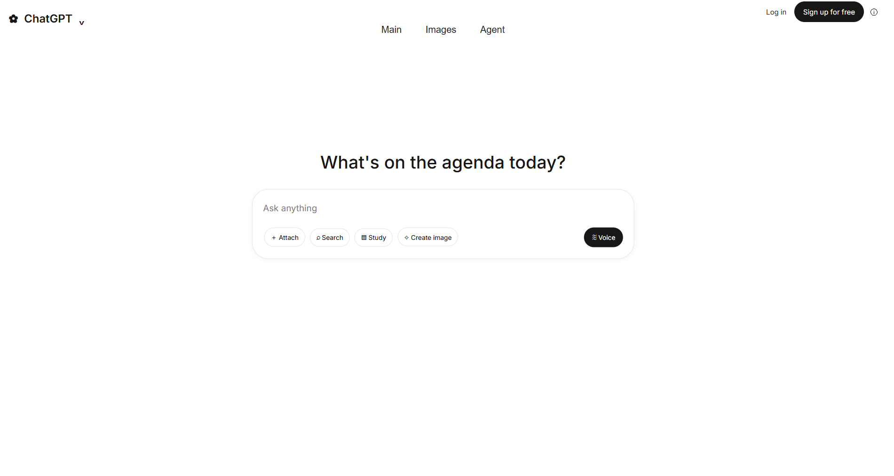
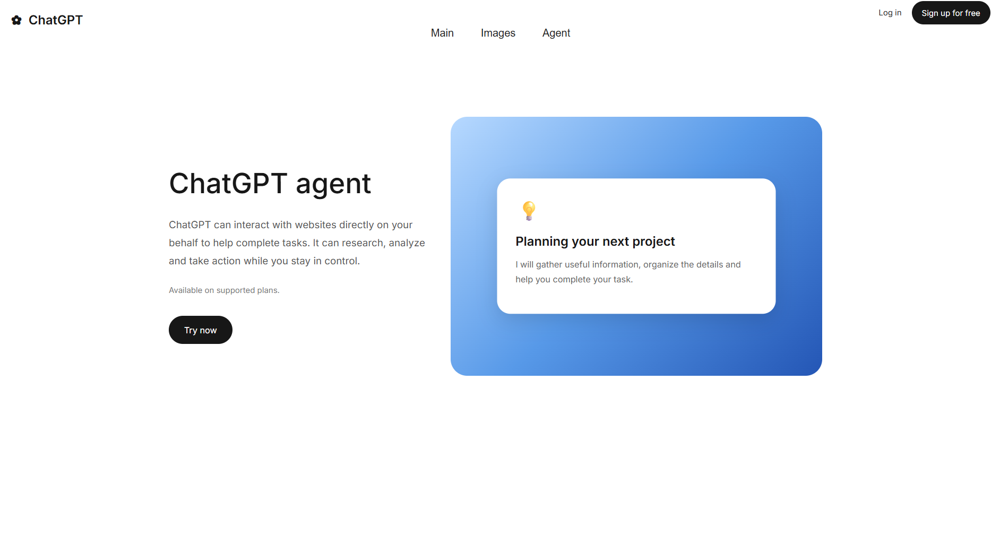

<div align="center">

# ✨ Marketing Website

### A modern, multi-page web experience built with HTML & CSS

**Clean design · Beautiful visuals · Simple navigation**

[Explore the Pages](#-pages) · [Tech Stack](#-built-with) · [Run Locally](#-run-locally)

</div>

---

## 🌟 About the Project

Marketing Website is a polished front-end project focused on a clean user experience, a consistent look across pages, and eye-catching visual sections. Each page has its own purpose while sharing the same easy-to-use navigation.

## 🚀 Pages

### 🏠 Main — A welcoming starting point
A minimal landing page with a headline, a prompt-style input area, and quick action buttons.

**Screenshot:**  
Add a screenshot of the page at `screenshots/main.png`.



### 🖼️ Images — Explore creative ideas
A visual gallery featuring image cards, captions, and a “Discover something new” section.

**Screenshot:**  
Add a screenshot of the page at `screenshots/images.png`.

MarketingWebsite/screenshots/2.png
### 🤖 Agent — Meet the assistant
A split layout with an introduction on the left and a blue visual panel with a floating information card on the right.

**Screenshot:**  
Add a screenshot of the page at `screenshots/agent.png`.



> **Adding screenshots:** Create a folder named `screenshots` in the project directory and save your actual page screenshots using the exact names above. GitHub will display them here automatically once the files are committed.

---

## 🧰 Built With

| Technology | Purpose |
|---|---|
| **HTML5** | Semantic page structure |
| **CSS3** | Layout, colors, gradients, spacing, and visual styling |
| **Google Fonts — Inter** | Clean, modern typography |

## 📁 Project Structure

```text
MarketingWebsite/
├── index.html       # Main page
├── index.css        # Main page styles
├── images.html      # Images gallery
├── images.css       # Gallery styles
├── agent.html       # Agent page
├── agent.css        # Agent page styles
├── logo.png         # Browser tab icon (favicon)
├── screenshots/
│   ├── main.png
│   ├── images.png
│   └── agent.png
└── README.md
```

*If your logo has a different filename or extension, use its real name instead of `logo.png`.*

## ⚡ Run Locally

No installation or build step is needed.

1. Clone the repository:

   ```bash
   git clone https://github.com/EstherLogic/MarketingWebsite.git
   ```

2. Open the `MarketingWebsite` folder.
3. Double-click `index.html` to open the site in your browser.
4. Use the navigation bar to move between **Main**, **Images**, and **Agent**.

## 🎨 Design Highlights

- Consistent navigation across the pages
- Clean typography and generous spacing
- Rounded corners and soft visual details
- Gradient artwork and image-gallery layout
- A lightweight static site with no build tools required
- Built without CSS Flexbox or Grid

## 📌 Notes

- This is a static front-end project.
- Some gallery images may be loaded from external URLs and require an internet connection.
- The screenshot files are placeholders until you add your real screenshots to the `screenshots/` folder.

---

<div align="center">

**Thanks for checking out Marketing Website!** ✨

*Designed and built with HTML & CSS.*

</div>
